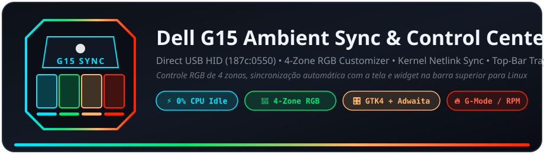
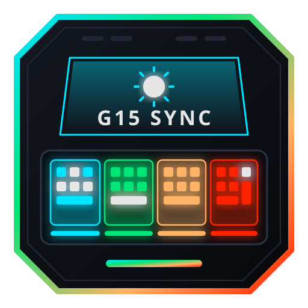

<div align="center">
  
  <br/><br/>

  [](https://github.com/murilogiatti/dell-g15-power-sync/actions/workflows/test.yml)
  [](https://opensource.org/licenses/MIT)
  

  <p>
    <a href="#english">🇺🇸 English (EN-US)</a> • <a href="#português">🇧🇷 Português (PT-BR)</a>
  </p>
</div>

---

<h2 id="english">🇺🇸 English (EN-US)</h2>

### Overview


**Dell G15 Ambient Sync & Control Center** combines an ultra-lightweight, event-driven hardware daemon (`g15-daemon`) with a native **Top-Bar System Tray Indicator + GTK4/Libadwaita Control Center** (`g15-tray`).

Built from scratch with a clean **Data-Oriented Design (DOD)** architecture, it eliminates polling loops (`sleep`) and heavy third-party CLI tools (`openrgb`):
- **Direct USB HID Communication (No OpenRGB Required)**: Talks directly to the Alienware AW-ELC controller (`187c:0550` / `187c:0551`) via Linux `/dev/hidraw*` (`HIDIOCSFEATURE` ioctls) using only the Python 3 standard library. Automatically queries the controller's firmware zone table (`0x20 0x02`) to support all Dell G15 variants (`5511`, `5515`, `5520`, `5525`, `5530`, `5535`).
- **100% Event-Driven (Zero Polling)**: Listens directly to Linux kernel `AF_NETLINK` (`NETLINK_KOBJECT_UEVENT`) and `inotify` sysfs/config events. Consumes **0% CPU** while idle and reacts instantaneously with a **150ms debounce**.
- **Top-Bar System Tray Widget (`StatusNotifierItem` + `Dbusmenu`)**: Integrates natively with GNOME (AppIndicator) and KDE Plasma:
  - **Mouse-Wheel Brightness Scroll**: Scroll up/down directly over the top-bar keyboard icon to step keyboard intensity (`0%`, `10%`, `30%`, `50%`, `75%`, `100%`).
  - **Instant Menu Actions**: Toggle *Ambient Sync*, set fixed brightness, toggle **G-Mode / Game Shift (`Fn+F9`)**, switch between 12 RGB color presets, select onboard hardware animations, switch thermal/power profiles (`power-saver`, `balanced`, `performance`), and view live `CPU`/`GPU` temperatures + fan RPM.
- **Native Hardware Hotkeys (`Fn+F5` & `Fn+F9`) + OSD Notifications**:
  - **`Fn+F9` (G-Mode / Game Shift)**: Toggles `performance` thermal profile, automatically switches the keyboard to **Pure Red (`#FF0000`)** while keeping your configured brightness/Ambient Sync intact, restores your previous color/effect profile when turned off, and displays a native desktop notification (GNOME / KDE Plasma).
  - **`Fn+F5` (Smart Backlight Cycle)**: Intercepts the keyboard backlight key to cycle cleanly through **`🔄 Ambient Sync (Auto)` ➔ `🔆 100% Fixed` ➔ `🔅 50% Fixed` ➔ `🌑 Off (0%)`** with on-screen OSD notifications.
- **GTK4 + Libadwaita Control Center (`g15-tray --show`)**:
  - **Dynamic Whole-Keyboard or 4-Zone RGB View**: Switch seamlessly between a single unified color picker for the entire keyboard or 4 independent zone pickers (`Zone 1 WASD`, `Zone 2 Center-Left`, `Zone 3 Center-Right`, `Zone 4 NumPad`), plus a labeled 12-color quick-preset grid (`Pure White`, `Ice Blue`, `Alienware Cyan`, `Cobalt Blue`, `Turquoise`, `Matrix Green`, `Solar Gold`, `Warm Amber`, `Orange`, `G15 Red`, `Magenta`, `Neon Purple`).
  - **Onboard Hardware Effects (0% CPU)**: Trigger native AW-ELC chip animations (`Static`, `Breathing`, `Pulse`, `Two-Color Morph`, `Spectrum Cycle`, `Rainbow Wave`) with a calibrated `10%–100%` speed slider (supporting mouse-wheel ±5% steps).
  - **Onboard Keyboard Memory (Boot Persistence)**: Save your favorite lighting profile directly to the keyboard microcontroller's internal user slot (`0x0061`) so your keyboard powers on with your chosen color before the OS loads.
  - **Built-in 1-Click Updater**: Automatically checks GitHub (`main`) for new versions in the background, alerts you via native OSD notification, and updates binaries, icons, and services in 1 click directly from the Tray menu or Control Center window (no terminal required).
- **Ready for Standard & Immutable Distros**: Works out of the box on **Ubuntu / Debian** and **Fedora Workstation / Kinoite / Silverblue (Atomic)** without `rpm-ostree` package layering, Flatpaks, or `pip` packages.

### ✨ Smart 5-Tier Ambient Sync + Hysteresis (±2%)
When **Ambient Sync** is enabled, your chosen RGB colors scale proportionally with screen brightness (`amdgpu_bl*`) using a ±2% deadband to prevent boundary flicker:
- 🌑 **Screen Off (DPMS)** ➔ **0% Keyboard** *(Hardware Dimmer `0x26` at 100% — LEDs off)*
- 🌙 **0–20% Screen** ➔ **10% Keyboard** *(Safe minimum floor while screen is active)*
- 🌘 **21–40% Screen** ➔ **30% Keyboard**
- 🌗 **41–60% Screen** ➔ **50% Keyboard**
- 🌔 **61–80% Screen** ➔ **75% Keyboard**
- 🌕 **81–100% Screen** ➔ **100% Keyboard** *(Capped at `230` / `#E6E6E6` by default to prevent hardware power-limiter drops)*

### 🚀 Installation & Upgrade
The installer automatically cleans up any legacy services or scripts from older versions and enables both `dell-g15-daemon.service` and `dell-g15-tray.service`:
```bash
git clone https://github.com/murilogiatti/dell-g15-power-sync.git
cd dell-g15-power-sync
./install.sh
```
To open the graphical Control Center at any time from the terminal or application launcher:
```bash
~/.local/bin/g15-tray --show
```

### 🗑️ Uninstallation
```bash
./uninstall.sh
```

---

<h2 id="português">🇧🇷 Português (PT-BR)</h2>

### Visão Geral


O **Dell G15 Ambient Sync & Control Center** une um daemon de hardware ultraleve orientado a eventos (`g15-daemon`) a um **Indicador na Barra de Notificações Superior + Painel de Controle GTK4/Libadwaita** (`g15-tray`).

Construído do zero com arquitetura **Data-Oriented Design (DOD)**, ele elimina loops de polling (`sleep`) e a dependência de ferramentas externas pesadas (`openrgb`):
- **Comunicação USB HID Direta (Sem OpenRGB)**: Conversa diretamente com o controlador Alienware AW-ELC (`187c:0550` / `187c:0551`) via `/dev/hidraw*` (`ioctl HIDIOCSFEATURE`) usando apenas a biblioteca padrão do Python 3. Consulta automaticamente a tabela de zonas do firmware (`0x20 0x02`), suportando todas as variantes do Dell G15 (`5511`, `5515`, `5520`, `5525`, `5530`, `5535`).
- **100% Orientado a Eventos (Zero Polling)**: Escuta diretamente eventos `AF_NETLINK` (`NETLINK_KOBJECT_UEVENT`) e `inotify` do kernel Linux. Consome **0% de CPU** em repouso e reage instantaneamente com **debounce de 150ms**.
- **Widget na Barra de Notificações (`StatusNotifierItem` + `Dbusmenu`)**: Integração nativa com GNOME (AppIndicator) e KDE Plasma:
  - **Scroll do Mouse no Ícone**: Role a roda do mouse sobre o ícone do teclado no topo da tela para ajustar o brilho (`0%`, `10%`, `30%`, `50%`, `75%`, `100%`) instantaneamente.
  - **Menu Rápido Completo**: Alterne entre *Brilho Automático (Ambient Sync)* e níveis fixos, ative o **Modo G / Game Shift (`Fn+F9`)**, escolha entre 12 presets de cores RGB, ative efeitos nativos de hardware, mude o perfil térmico/energia (`Economia`, `Equilibrado`, `Desempenho`) e acompanhe temperaturas `CPU`/`GPU` e rotação dos coolers (`RPM`).
- **Teclas de Atalho Físicas (`Fn+F5` e `Fn+F9`) + Notificações OSD**:
  - **`Fn+F9` (Modo G / Game Shift)**: Alterna o perfil de energia para `Desempenho`, aplica **Vermelho Puro (`#FF0000`)** mantendo o brilho atual configurado (automático ou manual), restaura suas cores/efeito anteriores ao desativar e exibe notificação nativa no GNOME / KDE Plasma.
  - **`Fn+F5` (Ciclo Inteligente de Iluminação)**: Utiliza a tecla física de iluminação do teclado para alternar entre **`🔄 Brilho Automático (Ambient Sync)` ➔ `🔆 100% Fixo` ➔ `🔅 50% Fixo` ➔ `🌑 Desligado (0%)`** com notificações na tela.
- **Painel de Controle GTK4 + Libadwaita (`g15-tray --show`)**:
  - **Alternância Dinâmica (Teclado Inteiro ou 4 Zonas)**: Alterne entre um seletor único para todo o teclado ou 4 seletores independentes por região (`Zona 1 WASD`, `Zona 2 Centro-Esq`, `Zona 3 Centro-Dir`, `Zona 4 NumPad`), acompanhados de uma grade identificada com 12 cores pré-selecionadas (`Branco Puro`, `Azul Gelo`, `Ciano Alienware`, `Azul Cobalto`, `Turquesa`, `Verde Matrix`, `Ouro Solar`, `Âmbar Conforto`, `Laranja`, `Vermelho G15`, `Magenta`, `Roxo Neon`).
  - **Efeitos Nativos de Hardware (0% CPU)**: Acione animações processadas pelo próprio chip AW-ELC (`Estático`, `Respiração`, `Pulso`, `Transição 2 Cores / Morph`, `Ciclo Spectrum`, `Ondas Arco-Íris / Rainbow`) com escala de velocidade calibrada (`10%–100%` e ajuste de ±5% pela roda do mouse).
  - **Gravação na Memória Interna do Teclado (Boot)**: Salve sua cor e efeito favoritos diretamente no slot de usuário (`0x0061`) do microcontrolador do teclado para que os LEDs já acendam configurados assim que o notebook ligar.
  - **Atualizador Integrado em 1 Clique**: Verifica automaticamente no GitHub (`main`) se há versões novas, avisa via notificação na tela e atualiza binários, ícones e serviços com 1 clique direto pelo menu do Tray ou pelo Painel de Controle (sem precisar abrir o terminal).
- **Compatível com Distros Tradicionais e Imutáveis**: Funciona nativamente no **Ubuntu / Debian** e no **Fedora Workstation / Kinoite / Silverblue (Atomic)** sem necessidade de *package layering* (`rpm-ostree`), Flatpaks ou pacotes `pip`.

### ✨ Sincronização Inteligente em 5 Níveis + Histerese (±2%)
Quando o **Ambient Sync** está ativo, as cores RGB escolhidas têm seu brilho escalado proporcionalmente ao brilho da tela (`amdgpu_bl*`) com banda morta de ±2% para evitar oscilações:
- 🌑 **Tela Desligada (DPMS)** ➔ **0% Teclado** *(Dimmer de Hardware `0x26` em 100% — LEDs apagados)*
- 🌙 **0–20% Tela** ➔ **10% Teclado** *(Piso mínimo seguro com a tela ligada)*
- 🌘 **21–40% Tela** ➔ **30% Teclado**
- 🌗 **41–60% Tela** ➔ **50% Teclado**
- 🌔 **61–80% Tela** ➔ **75% Teclado**
- 🌕 **81–100% Tela** ➔ **100% Teclado** *(Limitado por padrão ao pico `230` / `#E6E6E6` para proteger contra cortes do limitador de energia)*

### 🚀 Instalação e Atualização
O instalador remove automaticamente quaisquer scripts ou serviços de versões antigas e ativa tanto o `dell-g15-daemon.service` quanto o `dell-g15-tray.service`:
```bash
git clone https://github.com/murilogiatti/dell-g15-power-sync.git
cd dell-g15-power-sync
./install.sh
```
Para abrir o Painel de Controle gráfico a qualquer momento pelo menu de aplicativos ou terminal:
```bash
~/.local/bin/g15-tray --show
```

### 🗑️ Desinstalação
```bash
./uninstall.sh
```
